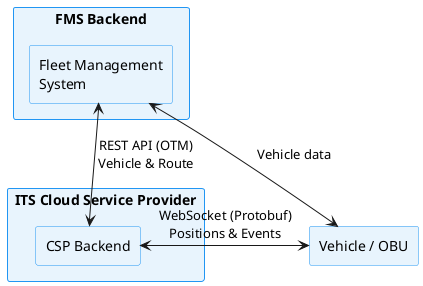

# Introduction

The ITS-FMS Interface is a standard for communication between logistics IT-suppliers (FMS) wanting to integrate Intelligent Transport Systems services and ITS Cloud Service Providers (CSP) that offer the required services. These services consist of real-time traffic and infrastructure events that are relevant on the current route of a truck.

The interface is an implementation of the [Open Trip Model 5.0](https://otm5.opentripmodel.org/), an open standard for communication about logistics and traffic. It has been developed with and already implemented by several market companies with support of the Dutch government. All certified Cloud Service Providers that have access to the relevant data provide their services following this standard.

The main goal is to make implementation of these services as easy as possible for all software suppliers in the logistics market, to make traffic flow more smooth, predictable and safe for everyone.

## Scope and objective

With the ITS-FMS interface, a set of C-ITS use cases, based on the use cases defined by the Talking Traffic project, are linked to logistics IT-systems (such as Fleet Management Systems), with a specific focus towards logistics operators.

The following use cases are **currently supported**:

- Traffic light status and timing information from intelligent traffic light controllers (iVRI)
- Priority allocation at iVRIs
- Lane configuration and variable message sign information
- Early warning messages from approaching emergency vehicles
- Dynamic location update frequency control

Additional use cases are defined in the [Protobuf specification](protobuf.md) and may become available in future versions. See [Event codes](event-codes.md) for the full list.

This set of applications is characterized by low-latency services that make use of cellular communication services.

## Target group

This document is intended for logistics IT-suppliers wanting to integrate ITS services. The document is a technical key specification for the connection between Fleet Management Systems and our platform.

## High level architecture

The interface consists of two types of communication:

- **REST API (JSON over HTTPS)** - For static data: vehicle and route information, based on the Open Trip Model
- **WebSocket (Protocol Buffers over WSS)** - For dynamic data: real-time location updates, ITS events, control messages, and time synchronization

There are multiple implementation options for FMS systems:

1. **Backend-to-backend** - All communication goes through the FMS backend
2. **Direct to vehicle** - Communication goes directly from the on-board unit to us
3. **Hybrid** - REST API via the backend, WebSocket directly from the vehicle

## Interface flow

The following steps describe the typical flow for connecting to our platform:

1. **Announce vehicle** - Register the vehicle using the REST API (`PUT /vehicles`)
2. **Announce route** - Register the route using the REST API (`PUT /routes`) - required when iVRI priority is enabled
3. **Open WebSocket** - Open one WebSocket connection per vehicle over WSS
4. **Send location updates** - Start communication by sending location updates in Protobuf over the WebSocket
5. **Respond to time sync** - Respond to timestamp requests to keep the connection open, and keep sending location updates
6. **Receive events** - Receive real-time ITS event messages

!!! warning "Inactivity timeout"
    If no activity is detected on an open WebSocket during 5 minutes, the connection will be closed.

## Abbreviations

| Abbreviation | Description |
|---|---|
| API | Application Programming Interface |
| C-ITS | Cooperative Intelligent Transport Systems |
| CSP | (ITS) Cloud Service Provider |
| FMS | Fleet Management System |
| ITS | Intelligent Transport Systems |
| iVRI | Intelligente VerkeersRegelInstallatie (intelligent Traffic Light Controller) |
| JSON | JavaScript Object Notation |
| OBU | On Board Unit |
| OTM | Open Trip Model |
| REST | Representational State Transfer |

## References

- [Open Trip Model documentation](https://www.opentripmodel.org)
- [CROW standards on C-ITS](https://www.crow.nl/thema-s/verkeersmanagement/landelijke-ivri-standaarden)
- [JSON standards](https://www.json.org)
- [Protocol Buffers](https://developers.google.com/protocol-buffers)
