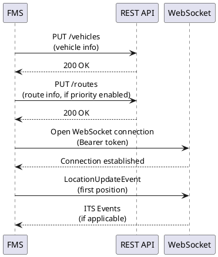
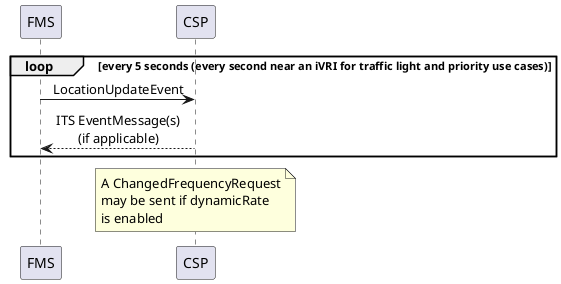
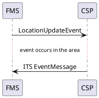
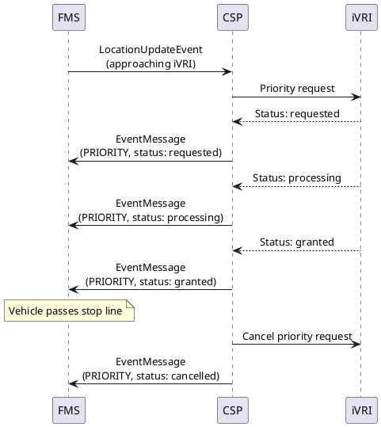
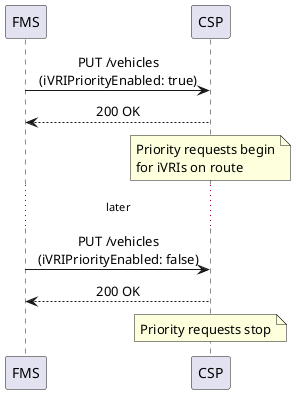
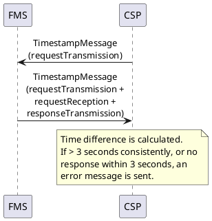
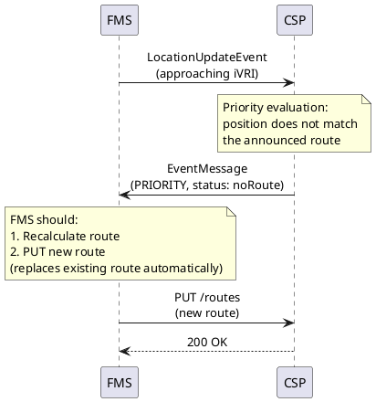

# Sequence diagrams

## First-time connection

When an FMS connects for the first time, the vehicle information must be registered via the REST API before opening a WebSocket connection.

If priority use cases are desired, route information **must** be provided before the trip starts. For other use cases, providing route information is recommended as it enables the CSP to provide events earlier.

## Regular position flow (position driven)

In position-driven event matching, events are checked each time a location update is received.

The FMS party must provide a location update **at least once every 5 seconds** (0.2 Hz) for each active vehicle. The traffic light and priority use cases need **at least one update per second** (1 Hz) near an iVRI; see [Location updates](websocket.md#location-updates) for how this works with and without `dynamicRate`. Based on this location, the CSP checks for new, updated, or deleted events and sends them over the WebSocket.

## Regular position flow (event driven)

In event-driven matching, events are matched based on the last known or calculated position.

## iVRI priority flow

**Precondition:** Route must be registered via `PUT /routes` before the trip starts.

## Priority characteristics changed

When vehicle characteristics change (e.g., entering/leaving an area where priority is applicable), the FMS must update the priority state.

## Clock synchronization

## Unhappy flow: route tracking failed

When a vehicle approaches an iVRI, the CSP evaluates the priority request against the announced route. If the vehicle's position cannot be matched to that route (for example because the vehicle has deviated from it), no priority is requested and the FMS party is notified through a `PRIORITY` event message with status `noRoute`.

## Unhappy flow: disconnect

In case of disconnection, the recovery depends on which announcements are still valid (see [Connection lifetime and reconnection](websocket.md#connection-lifetime-and-reconnection)):

| Scenario | Action required |
|---|---|
| Vehicle announced less than 24 hours ago | Only reconnect the WebSocket |
| Vehicle announced 24 hours ago or more | Send `PUT /vehicles`, then reconnect the WebSocket |
| Route announced 12 hours ago or more (or past its `endTime`) | Send `PUT /routes` if a route is still needed |
