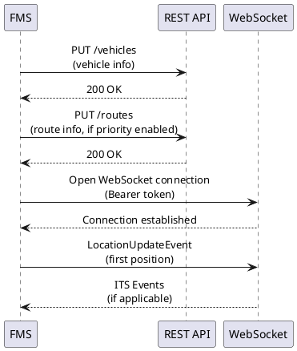
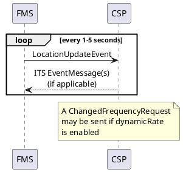
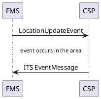
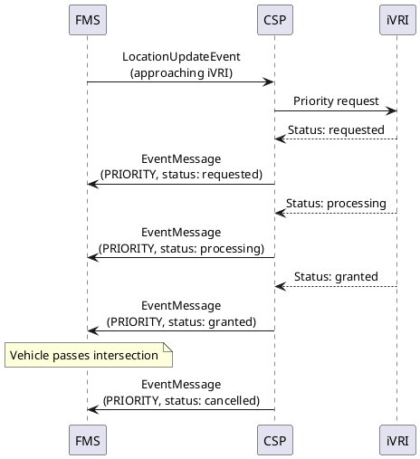
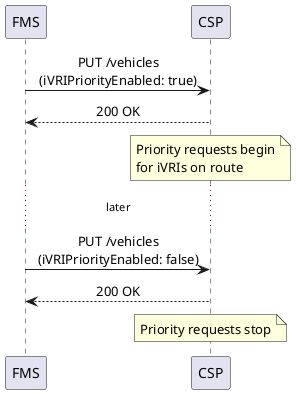
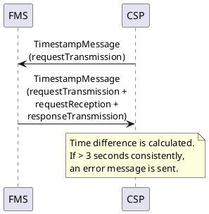
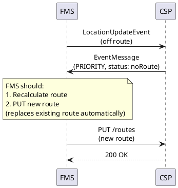

# Sequence diagrams

## First-time connection

When an FMS connects for the first time, the vehicle information must be registered via the REST API before opening a WebSocket connection.

If priority use cases are desired, route information **must** be provided before the trip starts. For other use cases, providing route information is recommended as it enables us to provide events earlier.

## Regular position flow (position driven)

In position-driven event matching, events are checked each time a location update is received.

The FMS party must provide a location update **at least once every 5 seconds** (0.2 Hz) for each active vehicle. Based on this location, we check for new, updated, or deleted events and send them over the WebSocket.

## Regular position flow (event driven)

In event-driven matching, events are matched based on the last known or calculated position.

## iVRI priority flow

**Precondition:** Route must be registered via `PUT /routes` before the trip starts.

## Priority characteristics changed

When vehicle characteristics change (e.g., entering/leaving an area where priority is applicable), the FMS must update the priority state.

## Clock synchronization

## Unhappy flow: route tracking failed

If a vehicle deviates from its route for too long, priority functionality may fail. The FMS party is notified through a control message.

## Unhappy flow: disconnect

In case of disconnection, the recovery depends on how long the connection has been down:

| Scenario | Action required |
|---|---|
| Reconnect within 24 hours | Only reconnect the WebSocket |
| Reconnect after 24 hours | Re-submit vehicle and route via REST API, then reconnect WebSocket |
